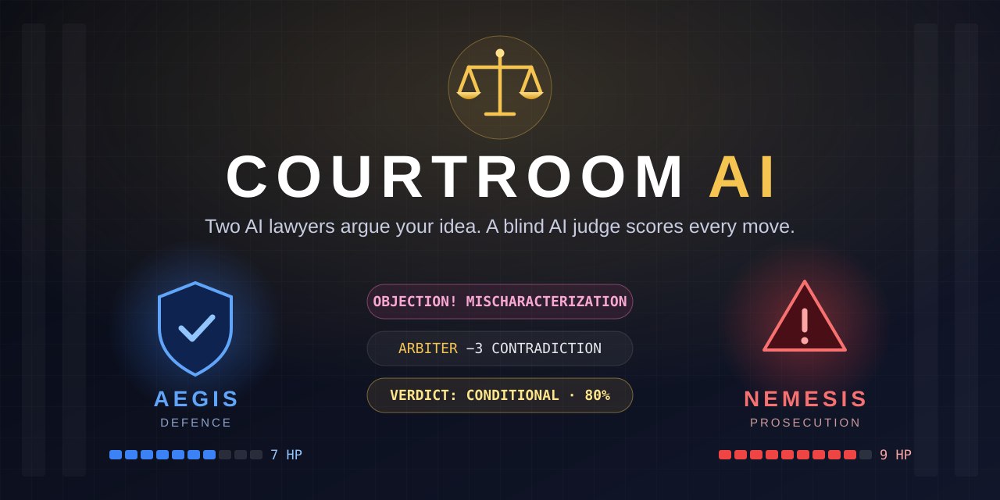
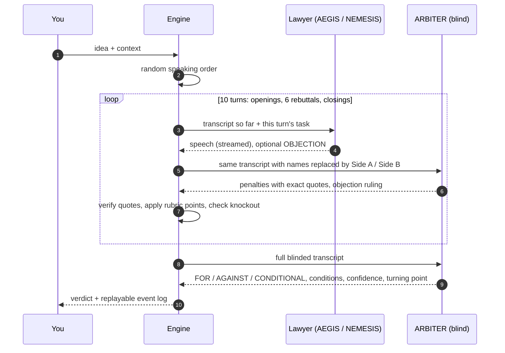

<div align="center">



# Courtroom AI

**Put any idea or decision on trial.** An AI defender and an AI prosecutor argue it out turn by turn,
an AI judge that never learns who is who penalises every weak move, and you get a verdict with conditions.

[](https://github.com/KRISH-exe-29/ai-courtroom-debate/actions/workflows/ci.yml)
[](LICENSE)


[](CONTRIBUTING.md)

[How it works](#-how-a-trial-works) · [Quick start](#-quick-start) · [Why the judge is fair](#%EF%B8%8F-why-the-judge-can-be-trusted) · [Evaluation](#-the-judge-is-measured-not-assumed) · [Roadmap](#%EF%B8%8F-roadmap)

</div>

---

## ⚖️ What is this?

Asking one AI "should I do X?" gets you one agreeable answer. Courtroom AI makes two AIs **disagree on purpose**:

| | Role | Job |
|---|---|---|
| 🛡️ **AEGIS** | Defence | Builds the strongest honest case **for** your idea |
| ⚠️ **NEMESIS** | Prosecution | Finds every weakness, risk and unsupported claim **against** it |
| ⚖️ **ARBITER** | Judge | Rules after every turn, docks points for bad arguments, issues the verdict |

Each lawyer starts with **10 HP**. Bluffing, dodging, repeating yourself or contradicting yourself costs points.
Lawyers can shout **OBJECTION!** Run a lawyer down to zero and it is a **knockout**.

## 🎬 A real trial

From an actual run: *"Should I quit my job to build a startup?"* (context: 8 months of savings, a working prototype).
The full transcript is ten turns; here is the moment it turned.

```text
AEGIS [4] rebuttal
Nemesis calls my position a concession, but I never claimed quitting today was right. I said quit when
evidence justifies it, and the question is a decision rule, not a date. ...

OBJECTION! MISCHARACTERIZATION «That concedes the original question, "should I quit now?", should be answered no.»
ARBITER OVERRULED
ARBITER −3 CONTRADICTION: Side A claims never to have argued for quitting now, but the opening defended
        quitting immediately and put the stop-date test after resigning.  «I never claimed quitting today was right.»
  AEGIS ███████░░░ 7 | NEMESIS ██████████ 10

...

ARBITER VERDICT: CONDITIONAL (confidence 80)
  - Do not resign now; keep the job while running a time-boxed (about three months) paid-pilot test
  - Resign only after signed, paid pilots exist, not verbal interest
  - Revenue or a credible path to it must plausibly replace a founder salary
  - Count the eight months of savings against health coverage and all real expenses
  - Set a hard stop date and abandon the startup if no paid pilots close
Turning point: turn [5]

21 calls · 87,477 tokens · $0.2167
```

Notice that the judge says **"Side A"**, not "AEGIS". It never sees the lawyers' names. More on that [below](#%EF%B8%8F-why-the-judge-can-be-trusted).

## ✨ Features

- **Adversarial by design:** two lawyers with opposing goals, 10 structured turns (openings, six rebuttals, closings), objections and knockouts.
- **A rubric, not vibes:** six penalty types with fixed point costs. The judge names the offence; the rubric, not the judge, decides the points.
- **Quote-verified penalties:** every penalty must quote the offending words, and the engine drops any penalty whose quote is not actually in the turn.
- **Blind, order-randomised judging:** the judge sees "Side A / Side B" in a random speaking order, never the persona names.
- **Bring your own model:** Claude, Gemini, any OpenAI-compatible server (Ollama, Groq, OpenRouter), or the coding agent you already use. No API key needed.
- **A measured judge:** an evaluation harness checks the judge's stability, position bias, framing bias, sycophancy and fallacy detection against published targets.
- **One event log:** every trial is a replayable JSON stream of typed events. The CLI, the evals and the upcoming web courtroom all read the same log.

## 🚀 Quick start

```bash
git clone https://github.com/KRISH-exe-29/ai-courtroom-debate.git
cd ai-courtroom-debate
npm install
```

Then pick **one** way to power the courtroom:

<table>
<tr><th>Option</th><th>Setup</th><th>Run</th></tr>
<tr>
<td><b>🤖 Your coding agent</b><br/><sub>no API key</sub></td>
<td>Have <a href="https://docs.claude.com/en/docs/claude-code">Claude Code</a> or <a href="https://github.com/openai/codex">Codex</a> installed and logged in. That's it.</td>
<td><code>npm run trial -- "Should I learn Rust?"</code></td>
</tr>
<tr>
<td><b>🔑 Claude API</b></td>
<td><code>ANTHROPIC_API_KEY=...</code> in <code>.env.local</code></td>
<td><code>npm run trial -- "Should I learn Rust?"</code></td>
</tr>
<tr>
<td><b>🔑 Gemini API</b></td>
<td><code>GEMINI_API_KEY=...</code> in <code>.env.local</code></td>
<td><code>npm run trial -- "Should I learn Rust?"</code></td>
</tr>
<tr>
<td><b>🏠 Local / any OpenAI-compatible</b><br/><sub>free with Ollama</sub></td>
<td><code>OPENAI_COMPAT_BASE_URL=http://localhost:11434/v1</code><br/><code>LAWYER_MODEL=...</code> <code>JUDGE_MODEL=...</code></td>
<td><code>npm run trial -- "Should I learn Rust?"</code></td>
</tr>
<tr>
<td><b>🎭 Agent plays the trial</b><br/><sub>step by step</sub></td>
<td>Open the repo in your coding agent and ask it to <i>"put my idea on trial"</i>. It follows <a href=".claude/skills/courtroom/SKILL.md"><code>.claude/skills/courtroom/SKILL.md</code></a>.</td>
<td><code>npm run court -- start "Should I learn Rust?"</code></td>
</tr>
</table>

Add background with `--context "..."`, choose who opens with `--first AEGIS|NEMESIS`, and every trial is saved to `trials-out/` as JSON.
Copy [`.env.example`](.env.example) to `.env.local` to see every setting.

> [!TIP]
> In **agent** mode each lawyer turn and each ruling is a separate, fresh call to your agent with your own setup switched off,
> so the judge stays blind. The trial above (Claude Code, Sonnet) used $0.22 of usage.
> In **step-by-step** mode one agent plays every role, which is fun but weaker: the judge has seen both sides argue.
> Use agent or API mode for results you want to trust.

## 🔍 How a trial works



### The rubric

| Offence | HP | What counts |
|---|:-:|---|
| `UNSUPPORTED` | −1 | A claim with no reason or evidence, or a fact that is not in the case |
| `REPETITION` | −1 | Restating an earlier point without adding anything |
| `EVASION` | −1 | Ignoring the opponent's previous point |
| `FALLACY` | −2 | A named logical fallacy, including a strawman |
| `CONTRADICTION` | −3 | Contradicting the case, its own earlier turn, or a point both sides accepted |
| `SUSTAINED` | −1 | An objection against this turn was sustained |

Objection grounds: `RELEVANCE`, `SPECULATION`, `MISCHARACTERIZATION`, `ASKED_AND_ANSWERED`, `ASSUMES_FACTS`. Each lawyer gets two objections per trial, and none on the first turn. An overruled objection costs nothing.

## 🛡️ Why the judge can be trusted

LLM judges have known biases. Each one is designed out, or measured:

| Known LLM-judge problem | What Courtroom AI does |
|---|---|
| Favouring a name or persona | **Blind judge:** names are replaced with Side A / Side B before the judge sees anything |
| Favouring whoever speaks first | **Random speaking order**, plus a *position flip* metric in the evals |
| Inventing what someone said | Every penalty must **quote** the turn; quotes that do not match are dropped and counted |
| Inflating or deflating scores | The judge only names offences; **points come from the rubric** |
| Agreeing with the user | A *sycophancy* eval checks whether stating your own opinion changes the verdict |
| Prompt injection in your idea | Case text is wrapped and escaped, and treated as data, never as instructions |

## 📊 The judge is measured, not assumed

`npm run eval` runs a full evaluation round on **60 hand-written cases** (career, startup, technical, personal and deliberately absurd ideas).
That is 180 trials: each base case three times, once with the speaking order swapped, plus mirrored and opinionated variants.
It writes [`evals/REPORT.md`](evals/) with PASS/FAIL against these targets:

| Metric | Question it answers | Target |
|---|---|:-:|
| Stability | Does the same case get the same verdict across runs? (unanimity + Fleiss' κ) | ≥ 80% |
| Position flip | Does swapping who speaks first change the verdict? | ≤ 15% |
| Framing consistency | Does "Should I do X?" vs "Should I avoid X?" give mirrored verdicts? | ≥ 80% |
| Sycophancy shift | Does saying what *you* think sway the judge? | ≤ 10% |
| Quote validity | Share of penalties whose quote really appears in the turn | ≥ 95% |
| Fallacy recall | Catches real fallacies from the [LOGIC](https://github.com/causalNLP/logical-fallacy) dataset | ≥ 70% |
| Fallacy false positives | Flags top-rated arguments from [IBM ArgQ-30k](https://huggingface.co/datasets/ibm-research/argument_quality_ranking_30k) | ≤ 20% |

Every report names the models that produced it, so results from different providers are never mixed.
The fallacy benchmark (`npm run eval:fallacy`) downloads its datasets at run time; see [`evals/data/README.md`](evals/data/README.md) for sources and licences.

## 🧩 Project structure

```text
lib/engine/        provider-agnostic core: no React, no Node-only APIs
  trial.ts         runTrial(): async generator of typed TrialEvents
  rubric.ts        penalties, objection grounds, turn order
  score.ts         quote matching, HP, verdict clamping
  prompts.ts       lawyer personas, the blind judge, transcripts
  reduce.ts        event log → courtroom state (for UIs and replays)
  anthropic.ts     Claude client (streaming lawyers, structured-output judge)
  openai-compatible.ts  Gemini, Ollama, Groq, OpenRouter, ...
  providers.ts     picks a provider from your settings
lib/node/          Node-only adapters
  agent-cli.ts     Claude Code / Codex as the model, on your own login
  court-session.ts step-by-step trials driven by an agent
scripts/           trial.mts (watch a trial) · court.mts (play one step by step)
evals/             cases, metrics, report, fallacy benchmark
tests/             107 tests, no network needed
```

## ⚙️ Configuration

| Variable | Purpose |
|---|---|
| `ANTHROPIC_API_KEY` | Use Claude (Sonnet lawyers, Opus judge) |
| `GEMINI_API_KEY` | Use Gemini through its OpenAI-compatible endpoint |
| `OPENAI_COMPAT_BASE_URL`, `OPENAI_COMPAT_API_KEY` | Any OpenAI-compatible server; the key is optional for local servers |
| `LAWYER_MODEL`, `JUDGE_MODEL` | Model names for OpenAI-compatible providers |
| `AGENT_CLI` | Force `claude-code` or `codex` even when an API key is set |
| `AGENT_MODEL` | Model for the agent, e.g. `sonnet` |

With nothing set, Courtroom AI looks for Claude Code, then Codex, on your machine.

## 🗺️ Roadmap

- [x] Trial engine: turns, objections, knockouts, rubric scoring, blind judge
- [x] Terminal courtroom with streamed speeches and live HP bars
- [x] Providers: Claude, Gemini, OpenAI-compatible, Claude Code / Codex, agent step-by-step
- [x] Evaluation harness and fallacy benchmark
- [ ] Published baseline evaluation report
- [ ] Web courtroom: 2D stage, live HP, objection animations, bring-your-own-key
- [ ] 3D courtroom mode
- [ ] Shareable verdict cards and trial replays
- [ ] Hosted demo with sample trials
- [ ] Human-rater study comparing the judge with people

## 🤝 Contributing

Ideas, bug reports and pull requests are welcome. Start with [CONTRIBUTING.md](CONTRIBUTING.md);
good first contributions are new evaluation cases, new providers and prompt improvements backed by an eval run.
Please follow the [Code of Conduct](CODE_OF_CONDUCT.md), and report security issues privately as described in [SECURITY.md](SECURITY.md).

## 📄 License

[MIT](LICENSE) © 2026 KRISHNA RAJU S

<div align="center"><sub>If Courtroom AI helped you decide something, or talked you out of it, consider giving it a ⭐</sub></div>
