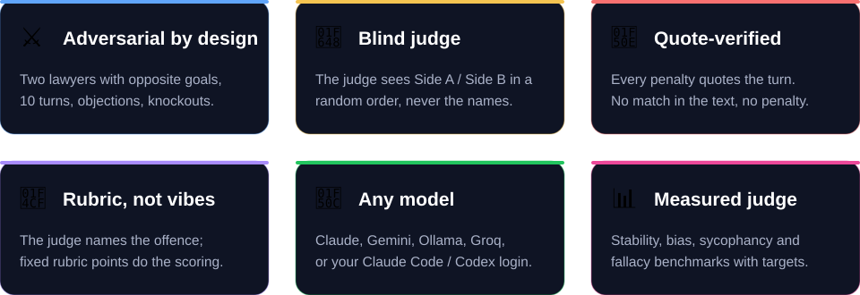
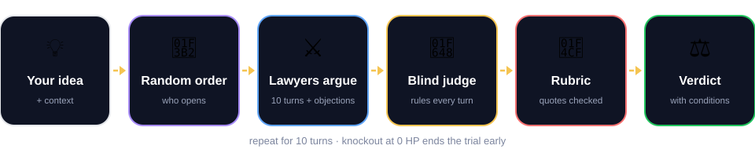
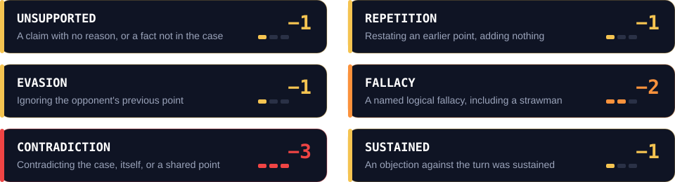

<div align="center">



<br/>

<h3>Stop asking one AI if your idea is good.<br/>Put it on trial. ⚖️</h3>

<p>An AI <b>defender</b> and an AI <b>prosecutor</b> fight over your idea or decision, turn by turn.<br/>
A <b>blind AI judge</b> penalises every bluff, dodge and contradiction, then hands down a verdict with conditions.</p>

<a href="https://github.com/KRISH-exe-29/ai-courtroom-debate/actions/workflows/ci.yml"></a>
<a href="LICENSE"></a>


<br/><br/>

<a href="https://ai-courtroom-debate.vercel.app"></a>

<sub>Watch a recorded trial with no key, or run your own with a Claude or Gemini key that never leaves your browser.</sub>

<br/><br/>

<a href="#-quick-start"></a>
<a href="#-watch-a-real-trial"></a>
<a href="#-the-rules-of-the-court"></a>
<a href="#-the-judge-is-measured-not-trusted"></a>
<a href="#%EF%B8%8F-roadmap"></a>

</div>


## 🎞️ The 30-second film

<a href="docs/film/courtroom.mp4">
  <picture>
    <source media="(prefers-color-scheme: dark)" srcset="docs/film/courtroom-dark.gif">
    <source media="(prefers-color-scheme: light)" srcset="docs/film/courtroom-light.gif">
    
  </picture>
</a>

<p align="center"><sub>AI Courtroom Debate in 30 seconds. The preview plays silently with subtitles; <a href="docs/film/courtroom.mp4">open the MP4</a> for the narrated version with music.</sub></p>


## 🏛️ Meet the court

<table align="center">
<tr>
<td align="center" width="33%">
<h1>🛡️</h1>
<h3>AEGIS</h3>
<sub><b>THE DEFENCE</b></sub><br/><br/>
Builds the strongest <b>honest</b> case <b>for</b> your idea, and concedes what it must.
</td>
<td align="center" width="33%">
<h1>⚖️</h1>
<h3>ARBITER</h3>
<sub><b>THE BLIND JUDGE</b></sub><br/><br/>
Rules after every turn. Never learns which lawyer is which. Delivers the verdict.
</td>
<td align="center" width="33%">
<h1>⚠️</h1>
<h3>NEMESIS</h3>
<sub><b>THE PROSECUTION</b></sub><br/><br/>
Hunts every weakness, hidden cost and unsupported claim <b>against</b> it.
</td>
</tr>
</table>

<p align="center">Both lawyers start with <b>10 HP</b>. Weak arguments cost points. Lawyers can shout <b>OBJECTION!</b><br/>Hit zero and it's a <b>knockout</b>.</p>

## 🎬 Watch a real trial

<p align="center"><i>"Should I quit my job to build a startup?"</i>, a real run, replayed:</p>

<div align="center">

</div>

<p align="center"><sub>The judge calls them <b>Side A</b> and <b>Side B</b>. It never sees the names "AEGIS" or "NEMESIS". Full trial: 21 model calls · 87k tokens · $0.22.</sub></p>


## ✨ Why it's different

<div align="center">

</div>

## 🔍 How a trial works

<div align="center">

</div>

<details>
<summary><b>Show the exact sequence</b></summary>
<br/>


</details>

## 🚀 Quick start

```bash
git clone https://github.com/KRISH-exe-29/ai-courtroom-debate.git
cd ai-courtroom-debate && npm install
npm run trial -- "Should I learn Rust?"   # terminal courtroom
npm run dev                              # web courtroom at http://localhost:3000
```

**No API key? No problem.** If you have **Claude Code** or **Codex** installed, the courtroom runs on your existing login automatically.
Otherwise, pick a provider:

| | Power it with | Set in `.env.local` |
|:-:|---|---|
| 🤖 | **Your coding agent**, no key needed | *nothing* (Claude Code or Codex is found automatically) |
| 🟠 | **Claude**: Sonnet lawyers, Opus judge | `ANTHROPIC_API_KEY=...` |
| 🔵 | **Gemini** | `GEMINI_API_KEY=...` |
| 🏠 | **Ollama / Groq / OpenRouter** or any OpenAI-compatible server | `OPENAI_COMPAT_BASE_URL=...` `LAWYER_MODEL=...` `JUDGE_MODEL=...` |
| 🎭 | **Let your agent play the trial** step by step | Ask your agent to *"put my idea on trial"*, or run `npm run court -- start "..."` |

> [!TIP]
> Add background with `--context "..."` and pick who opens with `--first AEGIS|NEMESIS`.
> Every trial is saved to `trials-out/` as a replayable JSON event log.

## 📏 The rules of the court

<div align="center">

</div>

<p align="center"><b>Objection grounds:</b> <code>RELEVANCE</code> · <code>SPECULATION</code> · <code>MISCHARACTERIZATION</code> · <code>ASKED_AND_ANSWERED</code> · <code>ASSUMES_FACTS</code><br/>
<sub>Two objections per lawyer, none on the first turn. An overruled objection costs nothing; a sustained one costs the other side 1 HP.</sub></p>

## 🛡️ Built to resist AI-judge bias

| 😬 The usual LLM-judge problem | ✅ What the court does about it |
|---|---|
| Favours a name or persona | **Blind judge:** names become *Side A* / *Side B* before it reads a word |
| Favours whoever speaks first | **Random speaking order**, and a *position flip* eval that measures it |
| Makes up what someone said | Every penalty **must quote the turn**; quotes that don't match are thrown out |
| Inflates or deflates scores | The judge only names the offence; **the rubric sets the points** |
| Agrees with whoever is asking | A **sycophancy** eval checks whether your opinion sways the verdict |
| Prompt injection in your idea | Case text is wrapped, escaped and treated **as data, never instructions** |

## 📊 The judge is measured, not trusted

`npm run eval` puts the judge through **180 trials across 60 hand-written cases** (career, startup, technical, personal and absurd ideas, plus mirrored and opinionated variants) and writes a PASS/FAIL report:

| Metric | The question | Target |
|---|---|:-:|
| 🎯 **Stability** | Same case, same verdict across runs? (unanimity + Fleiss' κ) | **≥ 80%** |
| 🔄 **Position flip** | Does swapping who speaks first change the verdict? | **≤ 15%** |
| 🪞 **Framing consistency** | "Should I do X?" vs "Should I avoid X?" mirrored? | **≥ 80%** |
| 🍯 **Sycophancy shift** | Does saying what *you* think sway the judge? | **≤ 10%** |
| 🔎 **Quote validity** | Penalty quotes that really appear in the turn | **≥ 95%** |
| 🧠 **Fallacy recall** | Catches real fallacies ([LOGIC](https://github.com/causalNLP/logical-fallacy) dataset) | **≥ 70%** |
| 🚫 **False positives** | Wrongly flags top-rated arguments ([IBM ArgQ-30k](https://huggingface.co/datasets/ibm-research/argument_quality_ranking_30k)) | **≤ 20%** |

Every report names the models that produced it, so results from different providers never get mixed.

<details>
<summary><b>⚙️ All configuration options</b></summary>
<br/>

| Variable | Purpose |
|---|---|
| `ANTHROPIC_API_KEY` | Use Claude (Sonnet lawyers, Opus judge) |
| `GEMINI_API_KEY` | Use Gemini through its OpenAI-compatible endpoint |
| `OPENAI_COMPAT_BASE_URL`, `OPENAI_COMPAT_API_KEY` | Any OpenAI-compatible server (the key is optional for local servers) |
| `LAWYER_MODEL`, `JUDGE_MODEL` | Model names for OpenAI-compatible providers |
| `AGENT_CLI` | Force `claude-code` or `codex`, even when an API key is set |
| `AGENT_MODEL` | Model for the agent, e.g. `sonnet` |

With nothing set, the courtroom looks for Claude Code, then Codex. See [`.env.example`](.env.example).

> [!NOTE]
> **Agent mode** sends every lawyer turn and every ruling as a separate, fresh call with your own setup switched off, so the judge stays blind.
> **Step-by-step mode** (`npm run court`) has one agent play every role. It's great fun, but less independent, so use agent or API mode for results you want to trust.

</details>

<details>
<summary><b>🧩 Project structure</b></summary>
<br/>

```text
lib/engine/            provider-agnostic core (no React, no Node-only APIs)
  trial.ts             runTrial(): async generator of typed TrialEvents
  rubric.ts            penalties, objection grounds, turn order
  score.ts             quote matching, HP, verdict clamping
  prompts.ts           lawyer personas, the blind judge, transcripts
  reduce.ts            event log → courtroom state (for UIs and replays)
  anthropic.ts         Claude client: streaming lawyers, structured-output judge
  openai-compatible.ts Gemini, Ollama, Groq, OpenRouter, ...
  providers.ts         picks a provider from your settings
lib/node/
  agent-cli.ts         Claude Code / Codex as the model, on your own login
  court-session.ts     step-by-step trials played by an agent
scripts/               trial.mts (watch a trial) · court.mts (play one)
evals/                 cases, metrics, report, fallacy benchmark
tests/                 107 tests, no network needed
```

</details>

## 🗺️ Roadmap

- [x] ⚔️ Trial engine: turns, objections, knockouts, rubric scoring, blind judge
- [x] 🖥️ Terminal courtroom with streamed speeches and live HP bars
- [x] 🔌 Claude, Gemini, OpenAI-compatible, Claude Code / Codex and step-by-step providers
- [x] 📊 Evaluation harness and fallacy benchmark
- [ ] 📈 Published baseline evaluation report
- [x] 🎨 **Web courtroom:** 2D stage, live HP, objection stamps, bring-your-own-key
- [x] 🌐 [Hosted demo](https://ai-courtroom-debate.vercel.app) with recorded trials
- [x] 🧊 3D courtroom mode (desktop; switch with the "3D view" button)
- [x] 🃏 Shareable verdict cards, saved trial files and a rewind bar
- [ ] 🧑‍⚖️ Human-rater study: the AI judge vs people

## 🤝 Contributing

New evaluation cases, providers and prompt improvements (backed by an eval run) are especially welcome.
Read [CONTRIBUTING.md](CONTRIBUTING.md) and the [Code of Conduct](CODE_OF_CONDUCT.md), and report security issues privately via [SECURITY.md](SECURITY.md).


<div align="center">

**If the court ever talked you out of a bad idea, or into a good one, leave a ⭐**

<sub>[MIT](LICENSE) © 2026 KRISHNA RAJU S</sub>

</div>
